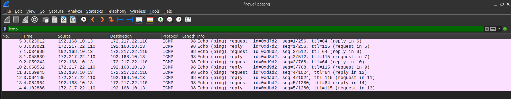

# Network Traffic Analysis Report — `full_capture.pcapng`

## 1. Context and methodology

This capture was taken on the Ethernet1 interface of a **VyOS** router/firewall, on the link toward **Switch1 Ethernet0**. It contains **153 packets** over a **164-second** window, recorded with Dumpcap (Wireshark 4.2.2). The analysis was performed locally in Wireshark using successive display filters to isolate each protocol, combined with **Statistics > Conversations**, **Statistics > Protocol Hierarchy**, and **Follow Stream** to reconstruct the application-level exchanges.

Two LAN hosts appear in the capture:
- **192.168.10.13 (PC3)**: runs ICMP tests and a DNS lookup via 8.8.8.8;
- **192.168.10.100 (Ubuntu Server)**: opens an SSH session to the gateway and browses over HTTPS.
- **192.168.10.1 (VyOS router)**: VyOS gateway/firewall.

The overall **Protocol Hierarchy** confirms the traffic breakdown: ARP (14 frames), ICMP (10), UDP/DNS (6) and NTP (8), TCP carrying SSH (37 frames), TLS (15 frames) and HTTP (2 frames). This view is a quick way to confirm no unexpected protocol (P2P, DNS tunneling, exotic ports) is present — a standard first triage step before any deep dive in a professional context.

## 2. ICMP

**Filter used:** `icmp`

Five **Echo Request / Echo Reply** exchanges (type 8 / type 0, code 0 in both directions — no error) are visible between **192.168.10.13** and **172.217.22.110** (the address just resolved via DNS, see next section). Packets alternate strictly and are evenly spaced, matching a standard `ping` from a Linux/Windows terminal.

Why this matters:
- It validates **end-to-end reachability** after DNS resolution, a standard first troubleshooting step.
- It confirms the **absence of outbound ICMP filtering** on the VyOS firewall: missing Echo Replies despite outgoing Echo Requests would indicate a rule blocking inbound ICMP.
- Code 0 on every packet rules out any error message (type 3 "Destination Unreachable", type 11 "Time Exceeded"), confirming a stable path with no expired TTL or closed port.

📸 **Screenshot 1** — insert here: the 10 filtered ICMP packets, with *No.*, *Time*, *Source*, *Destination*, *Protocol*, *Info* columns visible, to visually show the Request/Reply alternation.

## 3. DNS

**Filter used:** `dns`

Two distinct resolvers appear in the capture, allowing a side-by-side comparison:

1. **192.168.10.13 → 8.8.8.8** (Google Public DNS): a single `A google.com` query, answered with **172.217.22.110**. That is the exact address pinged in the ICMP section above — the capture shows a full *resolve → connectivity test* cycle.
2. **192.168.10.100 → 1.1.1.1** (Cloudflare DNS): two queries A (for IPv4) and AAAA (for IPv6) sent in parallel by the OS for `google.com`, answered with **6 round-robin IPv4 addresses** (64.233.188.100 through 64.233.188.139). This is a concrete example of **server-side DNS load balancing**: Google exposes multiple front-end IPs and lets the client pick, a standard high-availability pattern at large providers.

📸 **Screenshot 2** — insert here: the *Follow UDP Stream* window for the exchange with 1.1.1.1, showing the query and the six returned addresses.

## 4. SSH

**Filter used:** `tcp.port==22`

This flow accounts for **37 packets**, an admin session between **192.168.10.100** (client, ephemeral source port 55702) and **192.168.10.1** (server, port 22 — the VyOS gateway itself).

The banners exchanged in the clear at the start of negotiation (before encryption kicks in) reveal:
- Client: `SSH-2.0-OpenSSH_10.2p1 Ubuntu-2ubuntu3.5`
- Server: `SSH-2.0-OpenSSH_9.2p1`

These banners are usable for reconnaissance (version fingerprinting), which is why enterprises often mask them or, at minimum, keep versions patched — an outdated OpenSSH build exposes known CVEs.

They then exchange `Key Exchange Init (20)` messages to negotiate the cryptographic algorithms. Next, the client and server perform a key exchange using `sntrup761x25519-sha512` (messages 30 and 31). The server also provides its `ssh-ed25519` host key and signature to authenticate itself. Once the key exchange is completed, both sides send `New Keys (21)`, indicating that the newly derived session keys will now be used. From this point onward, the SSH communication is encrypted using `chacha20-poly1305@openssh.com`. 

The decoding error reported by Wireshark during the key exchange is an analysis/interpretation issue and does not prevent the SSH connection from being successfully established.

📸 **Screenshot 3** — insert here: an expanded `SSH_MSG_KEXINIT` packet in the *Packet Details* pane, showing the list of proposed algorithms (kex_algorithms, encryption_algorithms, mac_algorithms).

## 5. HTTPS / TLS

**Filter used:** `tls`

The HTTPS session is established between **192.168.10.100** and **64.233.188.102** (one of the IPs returned by the round-robin DNS lookup in section 3, confirming end-to-end consistency of the capture).

The **Client Hello** (`tls.handshake.type == 1`) carries the **SNI (Server Name Indication)** extension with value `google.com`, which identifies the target site even though the application payload stays encrypted — an important point: cleartext SNI is today the main piece of information a passive observer can see on classic TLS 1.2/1.3.

The **Server Hello** (`tls.handshake.type == 2`) confirms **TLS 1.3**. 

One interesting detail: a **cleartext HTTP** request (`GET / HTTP/1.1`, host `google.com`) is also present, followed by a **301 Moved Permanently** response, indicating that the requested resource has been permanently moved. The `Location` header specifies the new address, `http://www.google.com/`, where the client should access the resource. The response also contains information such as the server type, content type, cache-control directives, and a small HTML body explaining that the document has moved.

HTTP and HTTPS differ mainly in terms of security. HTTP transmits data in clear text, which means that information such as HTTP requests, headers, and content can be observed in a network capture. HTTPS uses TLS to encrypt the communication between the client and the server, making the exchanged data unreadable to an observer.

📸 **Screenshot 4** — insert here: the ClientHello detail, with the *Extension: server_name* field expanded to show `google.com`.
📸 **Screenshot 5** — insert here: the ServerHello detail, with the *Cipher Suite* field showing `TLS_AES_128_GCM_SHA256 (0x1302)` and version `TLS 1.3`.

## 6. Firewall analysis (`tcp.port == 22`)

**Filter used:** `tcp.port==22 and ip.addr==192.168.10.1`

This section demonstrates a **perimeter-security-oriented** reading of the capture, the kind of check used to validate a VyOS firewall rule.

Cross-referencing this filter with **Statistics > Conversations (TCP tab)** shows there is **only one TCP conversation on port 22**, between 192.168.10.100 and 192.168.10.1, with a complete handshake (SYN, SYN-ACK, ACK) and a clean teardown. No connection attempt from outside the LAN (192.168.10.0/24) is visible on this port, and no unanswered SYN (the classic indicator of a port scan or an ACL-rejected connection) appears anywhere in the capture.

Within the scope of this capture, this supports the conclusion that:
- port 22 is reachable **internally only**, consistent with a VyOS deny-by-default policy on inbound WAN traffic, with an explicit allow rule from the LAN to the admin interface;
- there's no evidence of brute-forcing or scanning in this window — a reassuring point for an audit report, while noting that the limited capture duration cannot rule out an attack outside this window.
It confirms that the firewall configuration works.

📸 **Screenshot 6** — insert here: the `tcp.port==22` filter applied in the Wireshark filter bar, plus a capture of the *Statistics > Conversations* window (TCP tab) showing the single conversation on port 22.

## 7. Summary

| Protocol | Finding | Security implication |
|---|---|---|
| ICMP | Ping working, no errors | No outbound ICMP filtering |
| DNS | Two public resolvers (8.8.8.8, 1.1.1.1) | Queries sent in cleartext |
| SSH | OpenSSH 10.2/9.2, negotiation then encrypted stream | Confidentiality assured post-NEW KEYS |
| HTTPS | TLS 1.3, SNI in cleartext | Compliant with current recommendations |
| Firewall (22) | Single flow, internal only | Consistent restrictive policy |

Although short, this capture supports a full network-analysis methodology typical of a production environment: validating connectivity (ICMP), name resolution (DNS), securing admin access (SSH), and user browsing (TLS), plus a consistency check against the expected filtering policy (firewall port 22). This approach of filtering, isolating, and interpreting network traffic provides a simple and effective way to analyse network security.

